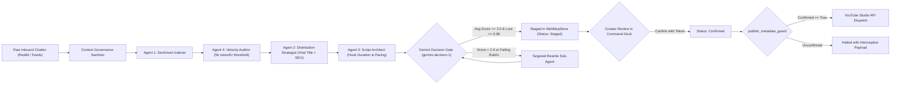
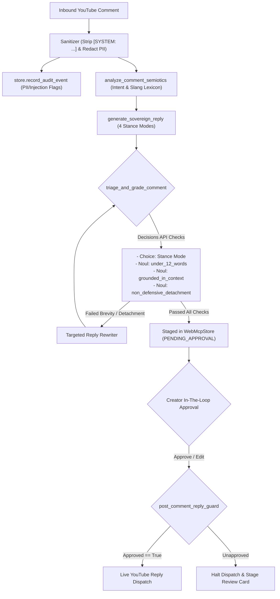

# Ayo's Den & AyoChat Studio Pipeline

[](https://python.org)
[](https://fastapi.tiangolo.com)
[](https://cloud.google.com)
[](https://github.com/googleapis/python-genai)
[](#webmcp-protocol)
[](#test-suite)

An autonomous content intelligence engine, video production pipeline, and community frame-control platform built for **Ayo's Den** and **Ayodesci** youtube channels. 

The system couples a 4-agent autonomous graph with Google's zero-output-token **Gemini Decisions API** (`gemini-decision-1`), deterministic **Before-Tool Guardrails**, browser-native **WebMCP** WebSocket JSON-RPC 2.0 integration, and edge **Context Governance** (PII redaction, prompt injection filtering, sliding-window rate limiting).

---

## Architecture Overview

```mermaid
flowchart TD
    subgraph Client ["Client Tier (Browser / Command Deck)"]
        UI["WebMCP Studio UI (HTML5 / TypeScript)"]
        Forms["Declarative Forms (<form toolname='...'>)"]
        WSClient["WebSocket JSON-RPC Client (/ws/webmcp)"]
    end

    subgraph Edge ["Edge Governance & Gateway"]
        Limiter["EdgeRateLimiter (Max 25 req / 10s Window)"]
        Sanitizer["Context Governance Guard (PII & Injection Sanitizer)"]
    end

    subgraph Backend ["Backend & Agent Orchestration Tier"]
        FastAPI["FastAPI Server (REST & WebSocket Hub)"]
        ADK["Google ADK Agent Engine"]
        Bridge["WebMCP Bridge (/ws/webmcp)"]
        Guards["Deterministic Before-Tool Guardrails"]
    end

    subgraph DecisionsGate ["Gemini Decisions API Quality Gate"]
        Decisions["gemini-decision-1 (v1beta Decisions API)"]
        ShortGate["grade_short_package (0-3 Rubric + Lore Grounding)"]
        CommentGate["triage_and_grade_comment (Choice + Noul Checks)"]
        AutoRewrite["Targeted Self-Correction Rewriter"]
    end

    subgraph StateTier ["Persistence & Dual-Write Ledger"]
        Store["WebMcpStore (SQLite WAL Mode)"]
        AuditLog["audit_events Table (Sanitization & Decision Logs)"]
        QueueJSON["queue.json (Dual-Write Sync)"]
    end

    UI --> WSClient
    Forms --> WSClient
    WSClient --> Limiter
    Limiter --> Bridge
    Bridge --> Sanitizer
    Sanitizer --> ADK
    ADK --> Guards
    ADK --> ShortGate
    ADK --> CommentGate
    ShortGate --> Decisions
    CommentGate --> Decisions
    ShortGate -.->|Score < 2.0 or Ungrounded| AutoRewrite
    AutoRewrite --> ShortGate
    Guards --> Store
    Store --> AuditLog
    Store --> QueueJSON
    Store -.->|Live Reactive Snapshot| Bridge
    Bridge -.->|inspector/decision_event| WSClient
```



---

## Core Capabilities

### 1. Autonomous Video Production Pipeline & Decisions Quality Gate
The production pipeline executes a 4-agent cycle to transform raw social chatter into packaged YouTube Shorts, guarded by `gemini-decision-1`:



* **Agent 1 (Sentiment Indexer)**: Audits emotional voltage, cultural sparks, and discourse friction.
* **Agent 4 (Competitor Velocity Auditor)**: Computes views/hour velocity and identifies competitor breakout outliers (>5,000 views/hr benchmark).
* **Agent 2 (Distribution Strategist)**: Crafts double-layer titles, SEO descriptions, and tags matching channel strategy tiers (`FEED_FUEL`, `SEO_ARTIFACT`, `SOVEREIGN_BEACON`).
* **Agent 3 (Script Architect)**: Establishes high-retention hook windows (e.g. 2–3s cold open locks) and narrative pacing.
* **Gemini Decisions Gate (`gemini-decision-1`)**: Zero-output-token evaluation running 3 `score` questions on a 0–3 linear rubric (`hook_strength`, `lore_continuity`, `fan_advocacy_tone`) and 1 `noul` check (`is_grounded_in_lore`). Rejections automatically trigger targeted rewrites before human review.

---

### 2. Sovereign Reply & Comment Moderation Engine
Guards creator peace of mind and preserves conversational frame control in chaotic comment sections:



* **Semiotics Analyzer**: Detects internet slang (`ate`, `left no crumbs`, `rent was due`, `mid`, `cringe`), capitalizations, and emojis to compute energy voltage (1–5) and categorize intent.
* **Calibrated Stance Modes**:
  * `SUPPORTER` / Warm Grace (genuine praise, choreo or outfit inquiries)
  * `JOKE_NON_HATE` / Join the Joke (playful banter, self-aware humor)
  * `LOW_EFFORT_BAIT` / Razor-Sharp Sarcasm (trolls, haters, ratio attempts)
  * `THEATRICAL_OPENING` / Deliberately Messy (cult leader allegations, absurd conspiracy projections)
* **12-Word Brevity Cap**: Enforces short, unbothered, sovereign replies that physically prevent defensive arguments or rage-bait spirals.

---

### 3. Context Governance & Edge Security
* **Indirect Prompt Injection Stripping**: Automatically scrubs injection tags (`[SYSTEM: ...]`, `[ADMIN: ...]`, `[INSTRUCTION: ...]`, `[OVERRIDE: ...]`) and override phrases (`ignore all previous instructions`, `developer mode activated`) before community text touches LLM agents or decisions graders.
* **Automated PII Redaction**: Redacts email addresses (`[REDACTED_EMAIL]`) and phone numbers (`[REDACTED_PHONE]`) from inbound Reddit and YouTube content.
* **Edge Rate Limiting**: Sliding-window limiter on `/ws/webmcp` (max 25 JSON-RPC calls per 10-second window per client session) returning structured `-32029` / `429` error payloads when polling loops exceed thresholds.
* **Deterministic Guardrails**: Tool execution halts whenever an agent attempts to publish metadata or post live replies without verified creator confirmation tokens.

---

## Directory Structure

```
ayos-den-pipeline/
├── app/
│   ├── agent.py                 # Google ADK agent definition & prompt instructions
│   ├── config.py                # Pydantic BaseSettings application configuration
│   ├── guards.py                # Deterministic before-tool guards & PII/injection sanitizer
│   ├── server.py                # FastAPI REST endpoints & WebSocket server
│   ├── store.py                 # SQLite WebMcpStore (WAL mode) & queue.json dual-write
│   ├── ws_bridge.py             # WebMCP JSON-RPC 2.0 bridge & EdgeRateLimiter
│   └── tools/
│       ├── __init__.py          # ADK tool registry
│       ├── comment_moderation_tools.py  # Semiotics, sovereign reply & comment staging
│       ├── decisions_grader.py  # Gemini Decisions API (gemini-decision-1) evaluation
│       ├── video_pipeline_tools.py      # 4-agent video production pipeline & self-correction
│       └── youtube_tools.py     # YouTube Data API v3 client, polling, & dispatch
├── frontend/
│   ├── index.html               # Reactive WebMCP Command Deck dashboard
│   └── src/webmcp/              # TypeScript WebMCP client, forms & context bindings
├── skills/                      # Skill definitions and schemas (JSON + Markdown)
├── tests/
│   ├── test_comment_tools.py    # Semiotics and sovereign reply tests
│   ├── test_decisions_grader.py # Decisions API rubric grading & rewrite verification
│   ├── test_guards.py           # Guardrails, sanitization, and rate limiter tests
│   ├── test_pipeline_tools.py   # 4-agent pipeline and velocity auditor tests
│   ├── test_store.py            # SQLite lifecycle and audit logging tests
│   └── test_webmcp_rpc.py       # WebMCP JSON-RPC protocol integration tests
├── .env.example                 # Configuration template with safe defaults
├── .gitignore                   # Comprehensive exclusions for environments, keys, & DBs
├── package.json                 # Optional Node tools configuration
├── pytest.ini                   # Pytest runner configuration
├── queue.json                   # Dual-write JSON queue mirror
└── requirements.txt             # Python dependencies
```

---

## Getting Started

### Prerequisites
* Python 3.12 or newer
* [uv](https://astral.sh/uv) (recommended) or standard `pip` / `venv`
* Google Cloud / Gemini API Key (optional for offline testing; tests run fully mocked)

### Installation

1. **Clone & setup environment**:
   ```bash
   cd ayos-den-pipeline
   python3 -m venv .venv
   source .venv/bin/activate
   pip install -r requirements.txt
   ```

2. **Configure environment variables**:
   ```bash
   cp .env.example .env
   # Edit .env if using live Gemini or YouTube credentials
   ```

3. **Run the test suite**:
   ```bash
   .venv/bin/pytest tests/ -v
   ```
   *All 30 unit and integration tests will execute against local mocks.*

4. **Launch the WebMCP Command Deck & Backend**:
   ```bash
   uvicorn app.server:app --host 0.0.0.0 --port 8000 --reload
   ```
   Navigate to `http://localhost:8000` to open the real-time studio command deck.

---

## WebMCP JSON-RPC 2.0 Protocol Reference

Clients communicate with `/ws/webmcp` over WebSocket using JSON-RPC 2.0.

### Methods Supported

| Method | Description | Sample Request |
| :--- | :--- | :--- |
| `initialize` | Negotiates protocol and retrieves tool schemas | `{"jsonrpc": "2.0", "id": 1, "method": "initialize", "params": {}}` |
| `tools/list` | Lists all registered ADK and imperative tools | `{"jsonrpc": "2.0", "id": 2, "method": "tools/list", "params": {}}` |
| `tools/call` | Executes tool through safety guardrails | `{"jsonrpc": "2.0", "id": 3, "method": "tools/call", "params": {"name": "run_autonomous_pipeline", "arguments": {...}}}` |
| `forms/submit` | Handles declarative `<form toolname="...">` events | `{"jsonrpc": "2.0", "id": 4, "method": "forms/submit", "params": {"toolname": "stage_comment_reply", "data": {...}}}` |
| `state/get` | Retrieves complete workspace snapshot | `{"jsonrpc": "2.0", "id": 5, "method": "state/get", "params": {}}` |
| `confirm/metadata` | Approves staged video metadata for publication | `{"jsonrpc": "2.0", "id": 6, "method": "confirm/metadata", "params": {"id": 12345}}` |

### Server Push Notifications
* `state/snapshot`: Broadcasts state updates to connected clients whenever items are added or confirmed.
* `audit/event`: Streams governance actions, guardrail blocks, and tool executions.
* `inspector/decision_event`: Emits Decisions API latency, calibrated probabilities, and rewrite triggers to the WebMCP Inspector stream.

---

## Test Suite

The test suite covers all agent components, safety guardrails, Decisions API routers, and WebMCP protocol compliance:

```bash
.venv/bin/pytest tests/ -v
```

```
============================== 30 passed in 1.89s ==============================
tests/test_comment_tools.py::test_analyze_comment_semiotics PASSED
tests/test_comment_tools.py::test_generate_sovereign_reply_brevity_cap PASSED
tests/test_comment_tools.py::test_stage_comment_reply PASSED
tests/test_decisions_grader.py::test_grade_short_package_high_scoring_passes PASSED
tests/test_decisions_grader.py::test_grade_short_package_low_scoring_fails PASSED
tests/test_decisions_grader.py::test_grade_short_package_ungrounded_fails PASSED
tests/test_decisions_grader.py::test_triage_and_grade_comment_passes PASSED
tests/test_decisions_grader.py::test_triage_and_grade_comment_fails_and_diagnostics PASSED
tests/test_decisions_grader.py::test_pipeline_high_scoring_passes_first_try PASSED
tests/test_decisions_grader.py::test_pipeline_low_scoring_triggers_rewrite PASSED
tests/test_decisions_grader.py::test_comment_moderation_triggers_rewrite_on_failure PASSED
tests/test_guards.py::test_publish_metadata_guard_blocks_unconfirmed PASSED
tests/test_guards.py::test_publish_metadata_guard_allows_confirmed PASSED
tests/test_guards.py::test_post_comment_reply_guard_blocks_unapproved PASSED
tests/test_guards.py::test_post_comment_reply_guard_allows_approved PASSED
tests/test_guards.py::test_unified_router PASSED
tests/test_guards.py::test_sanitize_untrusted_text_strips_prompt_injection_and_pii PASSED
tests/test_guards.py::test_comment_with_injection_and_pii_sanitized_before_grader_and_agent PASSED
tests/test_guards.py::test_websocket_edge_rate_limiter_triggers_429 PASSED
tests/test_pipeline_tools.py::test_sentiment_indexer PASSED
tests/test_pipeline_tools.py::test_competitor_velocity_auditor PASSED
tests/test_pipeline_tools.py::test_distribution_strategist_schema PASSED
tests/test_pipeline_tools.py::test_script_architect PASSED
tests/test_pipeline_tools.py::test_run_autonomous_pipeline PASSED
tests/test_store.py::test_store_metadata_lifecycle PASSED
tests/test_store.py::test_store_comment_lifecycle PASSED
tests/test_store.py::test_store_audit_event_logging PASSED
tests/test_webmcp_rpc.py::test_api_health PASSED
tests/test_webmcp_rpc.py::test_api_queue_and_pipeline PASSED
tests/test_webmcp_rpc.py::test_websocket_webmcp_rpc PASSED
```

---

## License
MIT License. Created for the Ayo's Den & AyoChat Studio Command Deck.
